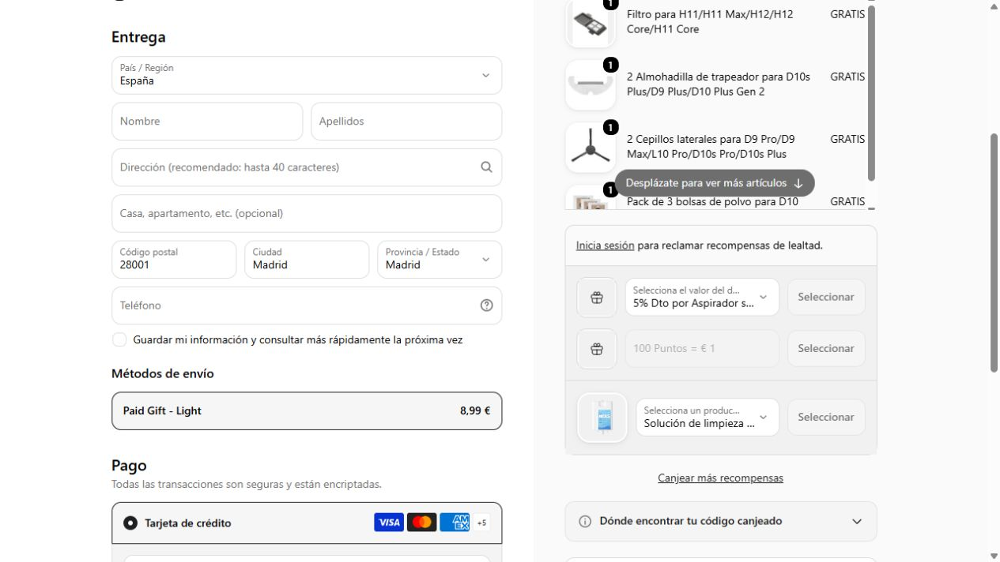

# Productos a cero comprobados

Observaciones del **24 de octubre de 2026**, para España. Cada ficha identifica un producto físico, tiene fotografía propia y conservó el precio cero en una cesta anónima de una unidad. Gemini revisó su descripción y condiciones. No se tramitaron pedidos ni se aportaron datos personales.

| Producto y variante exacta | Tienda | Artículo | Envío cotizado* |
|---|---|---:|---:|
| [Pack de 3 bolsas D10 Plus/D9 Plus](https://es.dreametech.com/products/pack-de-3-bolsas-de-polvo-para-d10-plus-d9-plus?variant=44404355399963) | Dreame España | 0 € | 8,99 € |
| [2 cepillos laterales D9 Pro/D9 Max/L10 Pro/D10s Pro/D10s Plus](https://es.dreametech.com/products/2-cepillos-laterales-para-d9-pro-d9-max-l10-pro-d10s-pro-d10s-plus?variant=51691595661676) | Dreame España | 0 € | 8,99 € |
| [2 mopas D10s Plus/D9 Plus/D10 Plus Gen 2](https://es.dreametech.com/products/2-almohadilla-de-trapeador-para-d10s-plus-d9-plus-d10-plus-gen-2?variant=47485933027611) | Dreame España | 0 € | 8,99 € |
| [Filtro H11/H11 Max/H12/H12 Core/H11 Core](https://es.dreametech.com/products/filtro-para-h11-h11-max-h12-h12-core-h11-core?variant=44404345602331) | Dreame España | 0 € | 8,99 € |
| [Gafas de Corazones Rojos](https://marronynegro.com/products/gafas-de-corazones-rojos?variant=60121417679182) | Marronynegro | 0 € | 2,99 € |
| [Bolsa Premium Dr.Grandel, papel 33 × 10 × 29 cm](https://etre-belle.es/products/dr-grandel-bolsa-premium?variant=53102394573123) | être belle España | 0 € | 4,50 € |

\* Cotizaciones de prueba para el código postal público 28001, Madrid. Pueden cambiar con destino, fecha y composición de cesta. Un artículo a cero con portes no significa entrega gratuita. La bolsa ya estaba registrada; esta revisión permitió concretar sus portes y confirmar su estado.

## La campaña de Dreame

La [colección oficial «Paga solo el envío»](https://es.dreametech.com/collections/paga-solo-el-envio) publica «Selecciona 5 o más accesorios – el precio se ajusta automáticamente». Se conservó esa condición en las evidencias: se observaron los cuatro productos por separado a cero, y también juntos, con **un solo envío de 8,99 €**. Una cesta de cinco unidades, duplicando el filtro, mantuvo subtotal cero y total 8,99 €. Son cuatro referencias diferentes, no cinco.

La pantalla previa al pago mostró las líneas gratis y los portes. Esto acredita el precio observado y la compra habilitada en ese momento; no garantiza aceptación o entrega por la tienda.

## Qué se descarta

- Un producto de Mercería Barcelona podía anunciar stock y precio cero, pero la cesta respondía «Lo siento, este producto no se puede comprar». Ese rechazo prevalece sobre el catálogo y Gemini.
- Los regalos sujetos a alcanzar un importe de carrito requieren otra compra y no cuentan como gratis independientes.
- Los objetos internos de aplicaciones de regalos o lotes, las devoluciones de pedidos, las fichas de prueba y la venta exclusivamente telefónica no son artículos gratuitos.
- Los casos comunicados como falsos positivos conservan su bloqueo de revisión aunque otra lectura de cesta o de IA sea favorable.

Los ejemplos no se precargan como ofertas vigentes al instalar el proyecto: deben volver a pasar la comprobación de precio, stock, foto, cesta y condiciones.
